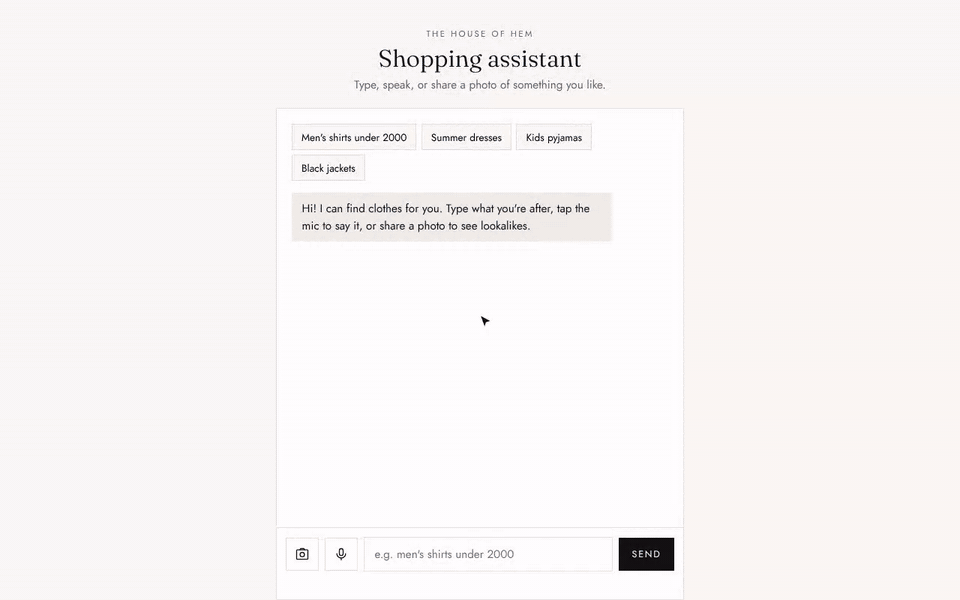
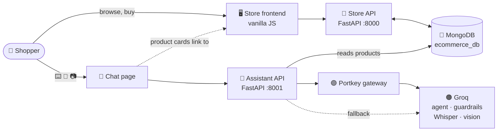

<div align="center">

# 🧵 The House of Hem

### A full-stack fashion store with an AI shopping assistant that understands text, voice and photos

*Shop women's, men's and kids' clothing in an editorial storefront, or ask the assistant: type it, say it, or share a photo to find lookalikes.*

[](https://www.python.org/)
[](https://fastapi.tiangolo.com/)
[](https://www.mongodb.com/atlas)
[](https://ai.pydantic.dev/)
[](https://groq.com/)
[](https://portkey.ai/)
[](https://developer.mozilla.org/en-US/docs/Web/JavaScript)
[](#-testing)
[](LICENSE)
[](#-contributing)

[✨ Features](#-features) •
[📸 Demo](#-demo) •
[🚀 Quickstart](#-quickstart) •
[🏗️ Architecture](#️-architecture) •
[💬 Support](#-support)

</div>

---

## 📖 Table of Contents

- [🌟 Overview](#-overview)
- [✨ Features](#-features)
- [📸 Demo](#-demo)
- [🏗️ Architecture](#️-architecture)
- [⚙️ How It Works](#️-how-it-works)
- [🧰 Tech Stack](#-tech-stack)
- [📋 Prerequisites](#-prerequisites)
- [🚀 Quickstart](#-quickstart)
- [🔐 Configuration](#-configuration)
- [👑 Admin Access](#-admin-access)
- [🔌 API Reference](#-api-reference)
- [🧪 Testing](#-testing)
- [☁️ Deployment](#️-deployment)
- [📁 Project Structure](#-project-structure)
- [🛠️ Troubleshooting](#️-troubleshooting)
- [🗺️ Roadmap](#️-roadmap)
- [🤝 Contributing](#-contributing)
- [🛡️ Security](#️-security)
- [📜 License](#-license)
- [🙏 Acknowledgements](#-acknowledgements)
- [💬 Support](#-support)

---

## 🌟 Overview

**The House of Hem** is two apps that share one MongoDB catalogue:

| | App | Folder | Port | What it does |
|---|---|---|---|---|
| 🏬 | **Online store** | project root (`backend/`, `frontend/`) | 8000 | Catalogue, search and filters, wishlist, bag, checkout, accounts, admin dashboard |
| 🤖 | **AI shopping assistant** | [`chatbot/`](chatbot/README.md) | 8001 | Search by text, voice or photo, behind guardrails; every result opens in the store |

One command, `python run_all.py`, starts both and wires them together.

> 📘 The assistant has its own detailed guide: **[chatbot/README.md](chatbot/README.md)**.

---

## ✨ Features

### 🏬 Online store

| | Feature | Description |
|---|---|---|
| 🗂️ | **Mega-menu navigation** | Women / Men / Kids menus with product types and featured picks |
| 🔎 | **Search, filter & sort** | Text search, price range, product type, sort by newest / price / name |
| ⚡ | **Quick add** | Add a size to the bag straight from the product grid |
| ❤️ | **Wishlist** | Save products from any card or product page |
| 👜 | **Persistent bag** | Stored per user on the server, so it follows you across devices |
| 💳 | **One-step checkout** | Prices are always re-read on the server, never trusted from the browser |
| 📦 | **Order history** | Every order with items, sizes, colours and totals |
| 🔐 | **Secure accounts** | bcrypt passwords and HMAC-signed tokens; optional Google Sign-In |
| 🛠️ | **Admin dashboard** | Add, edit and delete products, or bulk-import from Excel + an images zip |
| 🌱 | **Demo catalogue** | 100 products with photos are seeded on the first run |
| 📱 | **Responsive** | Mobile drawer menu and touch-friendly cards |

### 🤖 AI shopping assistant

| | Feature | Description |
|---|---|---|
| 🧠 | **Tool-calling agent** | pydantic-ai on Groq turns *"men's jeans under 2000"* into catalogue filters, and only shows products the tool returned |
| 🔤 | **Forgiving search** | Plurals, synonyms and filler words handled; suggests alternatives when nothing fits the budget |
| 🎤 | **Voice search** | Whisper transcribes the question, which then gets exactly the same answer as typed text |
| 📷 | **Photo lookalikes** | A vision model tags the garment, colours and style; products are ranked on tags plus colour-histogram similarity |
| 🛡️ | **Guardrails** | Prompt-injection and content-policy checks on input, and a policy check on every reply |
| 🔀 | **Gateway + fallback** | Portkey for observability, Groq directly if it fails; a safety-model outage never takes chat down |
| 🛍️ | **Shoppable results** | Every product card opens its page in the store |

---

## 📸 Demo

### 🤖 The shopping assistant



| Step | What happens |
|:---:|---|
| 1️⃣ | **Type** *"men's jeans under 2000"*: four pairs of jeans, cheapest first |
| 2️⃣ | **Say** *dresses under two thousand*: the transcript appears, then the dresses |
| 3️⃣ | **Share a photo** of a grey cardigan: cardigans ranked by type and colour |
| 4️⃣ | **Click a result**: the product opens in the store, ready to add to the bag |

> 🎬 Watch the [MP4 version](docs/chatbot-demo.mp4).
> ℹ️ Recorded with the real store, assistant and 100-product catalogue. The AI replies were scripted for the recording, because the machine that recorded it couldn't reach Groq.

### 🏬 The store


---

## 🏗️ Architecture



<details>
<summary>📝 Plain-text version</summary>

```
Shopper
  ├─ Store (port 8000)
  │    frontend/ (hash router, pages, components) ──> FastAPI (main.py)
  │       /products · /cart · /orders · /auth  ──> MongoDB (products, users, cart, orders)
  │
  └─ Shopping assistant (port 8001, chatbot/)
       Chat page ──> /chat          ─┐
                ──> /voice  (Whisper)┤─> input guardrails ─> pydantic-ai agent ─> search_products ─> MongoDB
                │                    └─> output guardrail ─> reply + product cards
                └─> /image-search ─> vision tags + colour histogram ─> ranked lookalikes

  Model calls: Portkey gateway → fallback to Groq directly
  Product cards → store page  STORE_URL/#/product/<id>
```

</details>

---

## ⚙️ How It Works

| Step | Part | What it does |
|:---:|---|---|
| 1️⃣ | 🚦 **Store startup** | Checks MongoDB, creates indexes, upgrades old data, and seeds the 100-product demo catalogue if it's empty |
| 2️⃣ | 🔐 **Login** | The store returns an HMAC-SHA256-signed token, sent as `Authorization: Bearer <token>`; the server identifies the user from the token alone |
| 3️⃣ | 👜 **Shopping** | Bag and orders are keyed by user id; checkout re-reads every price on the server |
| 4️⃣ | 🛡️ **Assistant guardrails** | Every typed or spoken message is screened for prompt injection and unsafe content |
| 5️⃣ | 🧠 **Agent search** | The agent calls `search_products(category, keyword, min_price, max_price)`, which builds the MongoDB query itself |
| 6️⃣ | 🎤 **Voice** | The browser records a clip; Whisper turns it into text, which takes step 4 onwards |
| 7️⃣ | 📷 **Photo** | The vision model tags the photo; products are scored on garment type (4.0), colour histogram (3.0), category (1.5), colour family (1.5) and style words (0.3) |
| 8️⃣ | 🛍️ **Results** | Product cards link to the store's product pages |

Full details of the assistant (prompts, ranking, guardrail policies, fallbacks) are in **[chatbot/README.md](chatbot/README.md#️-how-it-works)**.

---

## 🧰 Tech Stack

| Layer | Technology |
|---|---|
| 🐍 Language | Python 3.10+, vanilla JavaScript (ES modules), HTML, CSS |
| ⚡ Backend | FastAPI, Uvicorn, Pydantic v2, pydantic-settings |
| 🍃 Database | MongoDB Atlas via PyMongo (+ dnspython) |
| 🔐 Auth | bcrypt, HMAC-signed tokens, Google Sign-In (google-auth) |
| 🧠 AI agent | pydantic-ai with `FallbackModel` |
| 🟠 Models (Groq) | `gpt-oss-20b` (agent), `gpt-oss-safeguard-20b` + `llama-prompt-guard-2-86m` (guardrails), `whisper-large-v3-turbo` (speech), `qwen3.8-27b` (vision) |
| 🟣 Gateway | Portkey |
| 🖼️ Images | Pillow (validation, colour histograms), openpyxl (Excel import) |
| 📈 Observability | Logfire (optional) |
| 🧪 Testing | pytest, pytest-asyncio, mongomock |
| 🔤 Design | Fraunces + Jost (Google Fonts), monochrome with a dusty-rose accent |

---

## 📋 Prerequisites

- ✅ Python **3.10 or newer**
- ✅ A **MongoDB** database: a free [MongoDB Atlas](https://www.mongodb.com/atlas) cluster works
- ✅ A free **Groq API key** for the assistant: [get one here](https://console.groq.com/keys)
- ✅ *(Optional)* A **Portkey API key**: [portkey.ai](https://portkey.ai/)
- ✅ *(Optional)* A **Google OAuth Client ID** for Google Sign-In

---

## 🚀 Quickstart

### 1️⃣ Clone the repository

```bash
git clone https://github.com/lucky0731/VogueAgent.git
cd VogueAgent
```

### 2️⃣ Set up the store

```bash
python -m venv fashionagent

# 🪟 Windows
fashionagent\Scripts\activate
# 🍎 macOS / 🐧 Linux
source fashionagent/bin/activate

pip install -r requirements.txt
cp .env.example .env               # Windows: copy .env.example .env
```

Open `.env` and set `MONGO_URI`.

### 3️⃣ Set up the assistant

```bash
cd chatbot
python -m venv webchatbot          # or: uv venv webchatbot

# 🪟 Windows
webchatbot\Scripts\activate
# 🍎 macOS / 🐧 Linux
source webchatbot/bin/activate

pip install -r requirements.txt    # or: uv pip install -r requirements.txt
cp .env.example .env               # Windows: copy .env.example .env
cd ..
```

Open `chatbot/.env` and set `MONGO_URI` (the same as the store's) and `GROQ_API_KEY`.

### 4️⃣ Run both together

```bash
python run_all.py
```

| | Opens at |
|---|---|
| 🏬 Store | 👉 **http://localhost:8000** |
| 🤖 Assistant | 👉 **http://localhost:8001** |

`run_all.py`:
- uses each app's own environment, so there's nothing to activate first
- moves to the next free ports if 8000 or 8001 is busy, and points the assistant's links at the store's actual port
- shows both logs in one window (`[store]` / `[chat]`) and opens both in the browser
- stops both with Ctrl+C, and if one app stops, the other is stopped too

**Or run them one at a time:** `python main.py` in the project root starts the store, and `python main.py` in `chatbot/` starts the assistant.

---

## 🔐 Configuration

### 🏬 Store: `.env`

| Variable | Required | Default | Description |
|---|:---:|---|---|
| `MONGO_URI` | ✅ | — | MongoDB connection string |
| `SECRET_KEY` | ✅ in production | generated into `.secret_key` | Signs login tokens: `python -c "import secrets; print(secrets.token_urlsafe(48))"` |
| `TOKEN_TTL_HOURS` | | `168` (7 days) | How long a login lasts |
| `HOST` / `PORT` | | `127.0.0.1` / `8000` | Use `HOST=0.0.0.0` when deploying |
| `OPEN_BROWSER` | | `true` | Open the store on startup |
| `SEED_DEMO_DATA` | | `true` | Import demo products into an empty catalogue |
| `MAX_IMAGE_MB` | | `5` | Largest product image accepted (profile photos are capped at 2 MB) |
| `GOOGLE_CLIENT_ID` | | empty | Shows the Google Sign-In button |

### 🤖 Assistant: `chatbot/.env`

| Variable | Required | Default | Description |
|---|:---:|---|---|
| `MONGO_URI` | ✅ | — | The same connection string as the store |
| `GROQ_API_KEY` | ✅* | — | *Optional with Portkey, but used as its fallback |
| `PORTKEY_API_KEY` / `PORTKEY_GROQ_PROVIDER` | | empty / `groq` | Route calls through Portkey |
| `STORE_URL` | | `http://localhost:8000` | Where product cards link (`run_all.py` sets it automatically) |
| `HOST` / `PORT` | | `127.0.0.1` / `8001` | Server address |
| `*_MODEL_NAME` | | see [chatbot/README.md](chatbot/README.md#-configuration) | Swap any model without code changes |
| `LOGFIRE_TOKEN` | | empty | Send traces to Logfire |

> ⚠️ **Never commit real secrets.** `.env`, `chatbot/.env` and `.secret_key` are already in `.gitignore`. If a key is ever exposed, rotate it immediately.

---

## 👑 Admin Access

Register on the store, then grant yourself admin rights from the project folder:

```bash
python -m backend.make_admin                       # list users and who is admin
python -m backend.make_admin you@example.com       # grant admin
python -m backend.make_admin you@example.com --revoke
```

Reload the site and a **Manage store** button appears. Admin rights live only in the database (`is_admin` on the user), so nothing in the website can grant them.

**📊 Bulk import:** an `.xlsx` sheet with the columns `name, description, price, category, size, color, image` plus a zip of the images. `size` and `color` are comma-separated, and `image` names a file in the zip. See `demo_data/` for a working example.

---

## 🔌 API Reference

Both apps serve interactive docs at **`/docs`** while running.

### 🏬 Store (`:8000`)

| Method | Endpoint | Access | Description |
|---|---|:---:|---|
| `GET` | `/products` | 🌐 | List products. Query: `category`, `type`, `q`, `min_price`, `max_price`, `sort` (`newest`, `price_asc`, `price_desc`, `name`) |
| `GET` | `/products/{id}` · `/products/{id}/image` | 🌐 | One product · its image |
| `POST` · `PUT` · `DELETE` | `/products` · `/products/{id}` | 👑 | Add · edit · delete products (`DELETE /products` removes all) |
| `POST` | `/products/bulk` · `/products/bulk-upload` | 👑 | Add many (JSON) · import Excel + images zip |
| `POST` | `/auth/register` · `/auth/login` · `/auth/google` | 🌐 | Create an account · log in · Google sign-in |
| `GET` | `/auth/me` | 🔑 | The current user |
| `GET` · `PUT` | `/auth/profile` | 🔑 | View · update profile |
| `POST` · `DELETE` | `/auth/avatar` · `/auth/account` | 🔑 | Upload a profile photo · delete the account |
| `GET` · `DELETE` | `/cart` | 🔑 | The bag · empty it |
| `POST` | `/cart/items` | 🔑 | Add an item |
| `PATCH` · `DELETE` | `/cart/items/{item_id}` | 🔑 | Change quantity · remove an item |
| `POST` | `/orders/checkout` · `/orders` | 🔑 | Order the bag · buy one item now |
| `GET` | `/orders` | 🔑 | Order history |

🌐 public · 🔑 logged in · 👑 admin

### 🤖 Assistant (`:8001`)

| Method | Endpoint | Body | Description |
|---|---|---|---|
| `POST` | `/chat` | JSON `{"message": "..."}` | Typed messages |
| `POST` | `/voice` | multipart `audio` | Voice messages; adds `"transcript"` |
| `POST` | `/image-search` | multipart `image` | Photo lookalikes; adds `"tags"` |
| `GET` | `/config` | — | The store URL for product links |

Every assistant reply has the shape `{"type": "text" | "products", "message": "...", "data": [...]}`.

---

## 🧪 Testing

There are **60 tests** across both apps. They all run offline against an in-memory MongoDB (mongomock), with no database, network or API keys needed.

```bash
# 🏬 Store: 26 tests
pip install -r requirements-dev.txt
python -m pytest

# 🤖 Assistant: 34 tests (LLM calls are scripted)
cd chatbot
pip install -r requirements-dev.txt
python -m pytest
```

| Suite | Covers |
|---|---|
| 🔐 Store auth & account | Login by email or username, tampered tokens, admin spoofing, password changes revoking old tokens, profile and avatar rules, account deletion |
| 🛍️ Store shop & data | Private bags, server-side prices at checkout and buy-now, size validation, search, sort and type filters, Excel import, demo seeding, data migration |
| 🔎 Assistant search & chat | Plural keywords (the *"men's shirts under 2000"* regression), filters, the budget hint, each guardrail, outages failing open |
| 🎤📷 Assistant voice & photo | Transcripts through the pipeline, bad and empty clips, lookalike ranking, the colour fallback, bad and oversized files |

---

## ☁️ Deployment

Deploy the store and the assistant as two web services on [Render](https://render.com) (free tier), sharing the same `MONGO_URI`:

| | 🏬 Store | 🤖 Assistant |
|---|---|---|
| Root directory | repo root | `chatbot` |
| Build command | `pip install -r requirements.txt` | `pip install -r requirements.txt` |
| Start command | `python main.py` | `python main.py` |
| Environment | `MONGO_URI`, `SECRET_KEY`, `HOST=0.0.0.0` | `MONGO_URI`, `GROQ_API_KEY`, `HOST=0.0.0.0`, `STORE_URL=<store's public URL>` |

Render provides `PORT`. In MongoDB Atlas → **Network Access**, allow the hosts' outbound IP addresses (or `0.0.0.0/0`).

---

## 📁 Project Structure

```
.
├── ⚡ main.py                   # Store entry point: startup tasks, routers, static frontend
├── 🚀 run_all.py                # Start the store and the assistant together
├── 📂 backend/                  # Store API
│   ├── 🔐 auth.py, tokens.py    # Login tokens, current-user / admin checks
│   ├── ⚙️ config.py, 🍃 database.py, 🧱 models.py
│   ├── 🌱 seed.py               # Demo-data import
│   ├── 👑 make_admin.py         # Grant / revoke admin
│   ├── 🛣️ routes/               # products, products_bulk, cart, orders, auth, profile, google_auth
│   └── 🧰 utils/                # Catalogue, images, Excel importer, passwords, users
├── 📂 frontend/                 # Store website (no build step)
│   ├── 🖥️ index.html
│   └── 📂 src/                  # router, components, pages, services (API client), utils, style.css
├── 🤖 chatbot/                  # AI shopping assistant (separate app): see chatbot/README.md
│   ├── ⚡ main.py
│   ├── 📂 app/                  # api, config, database, chatbot/ (pipeline, agent, guardrails, voice, visual_search), utils/
│   ├── 🖥️ web/                  # Chat page
│   └── 🧪 tests/                # 34 offline tests
├── 🌱 demo_data/                # 100 demo products: spreadsheet + images
├── 🧪 tests/                    # 26 store tests
├── 🖼️ docs/                     # Screenshot and assistant demo (GIF + MP4)
├── 📦 requirements.txt, requirements-dev.txt
├── 🔑 .env.example
└── 📜 LICENSE                   # MIT
```

---

## 🛠️ Troubleshooting

<details>
<summary>🍃 <b>"Could not reach MongoDB within 10 seconds"</b></summary>

In MongoDB Atlas → **Network Access**, add your current IP address, and check the cluster isn't paused.
</details>

<details>
<summary>🔑 <b>"MongoDB rejected the login"</b></summary>

Check the username and password in `MONGO_URI`. Special characters in the password must be URL-encoded (`@` → `%40`).
</details>

<details>
<summary>🌐 <b>"DNS operation timed out" with <code>mongodb+srv://</code></b></summary>

Some home routers can't answer the DNS lookup Atlas needs. Both apps automatically retry with public DNS (8.8.8.8 / 1.1.1.1).
</details>

<details>
<summary>🚀 <b><code>run_all.py</code> says it can't find a virtual environment</b></summary>

It looks for `fashionagent/` (store) and `chatbot/webchatbot/` (assistant), or `.venv` / `venv`. Create them as in the Quickstart, or point to yours with `STORE_PYTHON` / `CHATBOT_PYTHON`.
</details>

<details>
<summary>📦 <b><code>No module named pip</code></b></summary>

The environment was created with **uv**: use `uv pip install -r requirements.txt`.
</details>

<details>
<summary>🔗 <b>Assistant product cards open a page that can't be reached</b></summary>

The store must be running. Use `python run_all.py`, or set `STORE_URL` in `chatbot/.env` to wherever the store runs.
</details>

<details>
<summary>🎤 <b>"Microphone access was blocked"</b></summary>

Allow the microphone from the browser's address bar, and open the chat on `localhost` (browsers only allow the mic on `localhost` or `https`).
</details>

<details>
<summary>👑 <b>No "Manage store" button</b></summary>

Grant admin from the command line: `python -m backend.make_admin you@example.com`, then reload.
</details>

<details>
<summary>🟦 <b>No Google Sign-In button</b></summary>

Set `GOOGLE_CLIENT_ID`, and add your site's address to the client's authorised JavaScript origins.
</details>

---

## 🗺️ Roadmap

- [x] 🏬 Online store with accounts, bag, checkout and admin
- [x] 🤖 AI shopping assistant with guardrails
- [x] 🎤 Voice search
- [x] 📷 Photo lookalike search
- [ ] 💬 Floating chat widget inside the store pages
- [ ] 💳 Payment gateway (Razorpay / Stripe test mode)
- [ ] ⭐ Product reviews and ratings
- [ ] 🧵 Conversation memory in the assistant
- [ ] 🇮🇳 Hindi and Hinglish voice search
- [ ] ☁️ Live deployment on Render
- [ ] 🔁 CI that runs both test suites on every pull request

> 💡 Have an idea? [Open an issue](../../issues) and let's discuss it!

---

## 🤝 Contributing

Contributions are what make open source great, and **all contributions are welcome**: bug fixes, features, docs or ideas. 🎉

1. 🍴 **Fork** the repository
2. 🌿 **Create** a feature branch
   ```bash
   git checkout -b feature/amazing-feature
   ```
3. 💾 **Commit** your changes
   ```bash
   git commit -m "Add amazing feature"
   ```
4. 📤 **Push** to your branch
   ```bash
   git push origin feature/amazing-feature
   ```
5. 🔃 **Open a Pull Request**

**Guidelines**

- 🐛 For bugs or larger changes, open an issue first to describe the problem or proposal
- 🧪 Run both test suites before opening a pull request
- 🎯 Keep pull requests focused on a single change
- 📝 Update documentation when behaviour changes
- 🙌 Be respectful and constructive in all discussions

---

## 🛡️ Security

If you discover a security vulnerability, **please don't open a public issue.** Instead, report it privately through GitHub's [security advisories](../../security/advisories/new) so it can be fixed before disclosure.

Built-in protections:

- 🔐 bcrypt passwords, and signed, expiring tokens that are revoked on password change
- 🧾 Server-side pricing at checkout
- 👑 Admin rights only from the command line
- 🛡️ Prompt-injection and content-policy guardrails on the assistant
- 📏 Upload type and size checks
- 🧼 HTML-escaped rendering

---

## 📜 License

Distributed under the **MIT License**. See [`LICENSE`](LICENSE) for details.

You're free to use, modify and distribute this project, including commercially, as long as you keep the license and copyright notice.

---

## 🙏 Acknowledgements

This project stands on the shoulders of some excellent open-source tools and services:

- ⚡ [**FastAPI**](https://fastapi.tiangolo.com/), [**Uvicorn**](https://www.uvicorn.org/) and [**Pydantic**](https://docs.pydantic.dev/): the web framework, server and validation
- 🍃 [**MongoDB Atlas**](https://www.mongodb.com/atlas) and [**PyMongo**](https://pymongo.readthedocs.io/): the database
- 🧠 [**pydantic-ai**](https://ai.pydantic.dev/) and [**Logfire**](https://logfire.pydantic.dev/): the agent framework and tracing
- 🟠 [**Groq**](https://groq.com/): fast inference for the agent, guardrails, Whisper and vision models
- 🟣 [**Portkey**](https://portkey.ai/): the LLM gateway
- 🗣️ [**OpenAI Whisper**](https://github.com/openai/whisper), [**gpt-oss**](https://openai.com/index/introducing-gpt-oss/), [**Meta Llama Prompt Guard**](https://www.llama.com/) and [**Qwen**](https://qwenlm.github.io/): the open-weight models
- 🖼️ [**Pillow**](https://python-pillow.org/) and [**openpyxl**](https://openpyxl.readthedocs.io/): images and Excel import
- 🧪 [**pytest**](https://pytest.org/) and [**mongomock**](https://github.com/mongomock/mongomock): offline testing
- 🔤 [**Google Fonts**](https://fonts.google.com/): Fraunces and Jost
- 🐇 [**Rare Rabbit**](https://thehouseofrare.com/): design inspiration for the editorial look
- 🎨 [**Shields.io**](https://shields.io/): README badges

---

## 💬 Support

Need help or want to share feedback?

- 🐛 **Found a bug?** [Open an issue](../../issues/new)
- 💡 **Have a feature idea?** [Start a discussion](../../discussions)
- ⭐ **Like the project?** Give it a star; it helps others find it!
- 🔁 **Share it** with anyone who might find it useful

---

<div align="center">

### 👨‍💻 Author

**Lucky Agrawal**

<a href="https://github.com/lucky0731">
  
</a>

[](https://github.com/lucky0731)
[](https://www.linkedin.com/in/lucky-agrawal/)

<br/>

Made with ❤️ and ☕ using FastAPI, MongoDB & pydantic-ai

⭐ **If you found this useful, please star the repo!** ⭐

</div>
