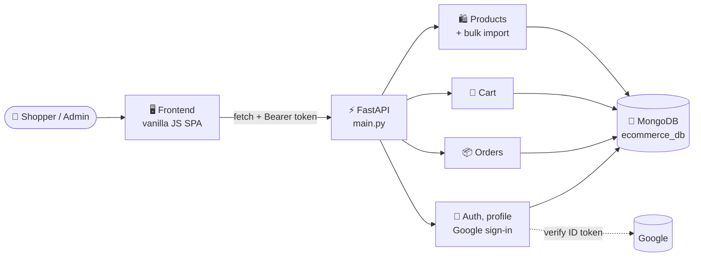

<div align="center">

# 🧵 The House of Hem

### A full-stack online clothing store built with FastAPI, MongoDB and vanilla JavaScript

*Browse, wishlist, bag and check out across women's, men's and kids' fashion, with secure accounts and a complete admin dashboard.*

[](https://www.python.org/)
[](https://fastapi.tiangolo.com/)
[](https://www.mongodb.com/atlas)
[](https://docs.pydantic.dev/)
[](https://developer.mozilla.org/en-US/docs/Web/JavaScript)
[](#-testing)
[](LICENSE)
[](#-contributing)

[✨ Features](#-features) •
[🚀 Quickstart](#-quickstart) •
[🏗️ Architecture](#️-architecture) •
[🤝 Contributing](#-contributing) •
[💬 Support](#-support)

</div>

---

## 📖 Table of Contents

- [🌟 Overview](#-overview)
- [✨ Features](#-features)
- [📸 Screenshots](#-screenshots)
- [🏗️ Architecture](#️-architecture)
- [⚙️ How It Works](#️-how-it-works)
- [🧰 Tech Stack](#-tech-stack)
- [📋 Prerequisites](#-prerequisites)
- [🚀 Quickstart](#-quickstart)
- [🔐 Configuration](#-configuration)
- [👑 Admin Access](#-admin-access)
- [🔌 API Reference](#-api-reference)
- [🧪 Testing](#-testing)
- [☁️ Deployment](#️-deployment)
- [📁 Project Structure](#-project-structure)
- [🛠️ Troubleshooting](#️-troubleshooting)
- [🗺️ Roadmap](#️-roadmap)
- [🤝 Contributing](#-contributing)
- [🛡️ Security](#️-security)
- [📜 License](#-license)
- [🙏 Acknowledgements](#-acknowledgements)
- [💬 Support](#-support)

---

## 🌟 Overview

**The House of Hem** is a complete e-commerce store for clothing: a FastAPI backend, a MongoDB catalogue and a fast, framework-free frontend with an editorial, monochrome-and-rose look.

It ships with a **100-product demo catalogue**, so a fresh install has something to show on its first run. It includes everything a real store needs:

- 🛍️ **Shop:** browse by category and product type, search, filter by price and sort
- ❤️ **Save:** wishlist, and quick-add sizes straight from the product grid
- 👜 **Buy:** a bag that follows your account across devices, and one-step checkout
- 👤 **Account:** email/password or Google Sign-In, profile photo, order history
- 🛠️ **Manage:** an admin dashboard to add, edit, delete or bulk-import products

---

## ✨ Features

| | Feature | Description |
|---|---|---|
| 🗂️ | **Mega-menu navigation** | Women / Men / Kids menus with product types (shirts, dresses, jeans…) and featured picks |
| 🔎 | **Search, filter & sort** | Text search over names and descriptions, price range, product type, sort by newest / price / name |
| ⚡ | **Quick add** | Hover a product card and add a size to the bag without leaving the grid |
| ❤️ | **Wishlist** | Save products for later from any card or product page |
| 👜 | **Persistent bag** | Stored on the server per user, so it follows you to any device |
| 💳 | **One-step checkout** | Prices are always re-read from the catalogue on the server, never trusted from the browser |
| 📦 | **Order history** | Every order with its items, sizes, colours and totals |
| 🔐 | **Secure accounts** | bcrypt password hashing and HMAC-signed login tokens; changing your password invalidates older tokens |
| 🟦 | **Google Sign-In** | Optional; the ID token's signature is verified on the server |
| 🖼️ | **Profile photo & account deletion** | Upload an avatar; delete the account (password confirmation required) |
| 🛠️ | **Admin dashboard** | Add, edit and delete products with images |
| 📊 | **Bulk import** | Upload an Excel sheet plus a zip of images to add many products at once |
| 🌱 | **Demo data on first run** | An empty catalogue is filled with 100 products and their photos |
| 🩺 | **Friendly startup checks** | MongoDB problems (Atlas IP list, wrong password, DNS) are explained in plain words |
| 📱 | **Responsive** | Mobile drawer menu, touch-friendly cards, no horizontal scrolling |

---

## 📸 Screenshots


---

## 🏗️ Architecture



<details>
<summary>📝 Plain-text version</summary>

```
Browser (frontend/: router, pages, components, API client)
  └─> FastAPI app (main.py)
       ├─ /products   list, search, filter, CRUD, bulk import   (admin for writes)
       ├─ /cart       per-user bag                             (login required)
       ├─ /orders     checkout, buy now, history               (login required)
       └─ /auth       register, login, profile, avatar, Google sign-in, delete account
            │
            └─> MongoDB (ecommerce_db: products, users, cart, orders)

Startup: check MongoDB → create indexes → migrate old data → seed demo catalogue if empty
```

</details>

---

## ⚙️ How It Works

| Step | Part | What it does |
|:---:|---|---|
| 1️⃣ | 🚦 **Startup** | Checks MongoDB is reachable, creates indexes, upgrades data from older versions, and seeds the demo catalogue if it's empty |
| 2️⃣ | 🖥️ **Frontend** | A small hash router (`#/`, `#/product/<id>`, `#/cart`…) renders pages from reusable components; no build step |
| 3️⃣ | 🔐 **Login** | The server returns a token signed with `SECRET_KEY` (HMAC-SHA256); the browser sends it as `Authorization: Bearer <token>` |
| 4️⃣ | 🪪 **Identity** | Every request identifies the user from the token alone, so a client can't claim to be someone else |
| 5️⃣ | 👜 **Bag & orders** | Keyed by user id; checkout re-reads every price from the catalogue on the server |
| 6️⃣ | 👑 **Admin** | Write routes for products require `is_admin` on the user record, which only the command-line tool can grant |

---

## 🧰 Tech Stack

- 🐍 **Python 3.10+**
- ⚡ **FastAPI** + **Uvicorn**: API server and static frontend
- 🧱 **Pydantic v2** + **pydantic-settings**: request models and typed configuration
- 🍃 **MongoDB** via **PyMongo** (+ dnspython for `mongodb+srv://` URIs)
- 🔐 **bcrypt**: password hashing
- 🟦 **google-auth**: Google Sign-In token verification
- 📊 **openpyxl**: Excel bulk import
- 🖥️ **Vanilla JavaScript (ES modules)**, **HTML** and **CSS**: no framework, no build step
- 🔤 **Fraunces** and **Jost** (Google Fonts)
- 🧪 **pytest** + **mongomock**: an offline test suite

---

## 📋 Prerequisites

- ✅ Python **3.10 or newer**
- ✅ A **MongoDB** database: a free [MongoDB Atlas](https://www.mongodb.com/atlas) cluster works
- ✅ *(Optional)* A **Google OAuth Client ID** for Google Sign-In, from the [Google Cloud Console](https://console.cloud.google.com/apis/credentials)

---

## 🚀 Quickstart

### 1️⃣ Clone the repository

```bash
git clone https://github.com/lucky0731/VogueAgent.git
cd VogueAgent
```

### 2️⃣ Create and activate a virtual environment

```bash
python -m venv fashionagent

# 🪟 Windows
fashionagent\Scripts\activate

# 🍎 macOS / 🐧 Linux
source fashionagent/bin/activate
```

### 3️⃣ Install dependencies

```bash
pip install -r requirements.txt
```

### 4️⃣ Configure environment variables

```bash
cp .env.example .env        # Windows: copy .env.example .env
```

Then open `.env` and set at least:

```env
MONGO_URI="mongodb+srv://<user>:<password>@<cluster>.mongodb.net"
```

### 5️⃣ Run it

```bash
python main.py
```

The store opens at 👉 **http://localhost:8000** (or the next free port if 8000 is busy). On the first run it fills the empty catalogue with the 100 demo products.

---

## 🔐 Configuration

All settings are environment variables or `.env` entries (see `.env.example`).

| Variable | Required | Default | Description |
|---|:---:|---|---|
| `MONGO_URI` | ✅ | — | MongoDB connection string |
| `SECRET_KEY` | ✅ in production | generated into `.secret_key` | Signs login tokens. Generate one with `python -c "import secrets; print(secrets.token_urlsafe(48))"` |
| `TOKEN_TTL_HOURS` | | `168` (7 days) | How long a login lasts |
| `HOST` / `PORT` | | `127.0.0.1` / `8000` | Use `HOST=0.0.0.0` when deploying |
| `OPEN_BROWSER` | | `true` | Open the store in the browser on startup |
| `SEED_DEMO_DATA` | | `true` | Import the demo products into an empty catalogue |
| `MAX_IMAGE_MB` | | `5` | Largest product image accepted (profile photos are capped at 2 MB) |
| `GOOGLE_CLIENT_ID` | | empty | Shows the Google Sign-In button |

> ⚠️ **Never commit real secrets.** `.env` and `.secret_key` are already in `.gitignore`. If a key is ever exposed, rotate it immediately.

---

## 👑 Admin Access

Register on the site, then grant yourself admin rights from the project folder:

```bash
python -m backend.make_admin                       # list users and who is admin
python -m backend.make_admin you@example.com       # grant admin
python -m backend.make_admin you@example.com --revoke
```

Reload the site and a **Manage store** button appears. Admin rights live only in the database (`is_admin` on the user), so nothing in the website can grant them.

**📊 Bulk import format:** an `.xlsx` sheet with the columns `name, description, price, category, size, color, image`. `size` and `color` are comma-separated, and `image` is a file name inside the uploaded zip. See `demo_data/bulk_upload.xlsx` and `demo_data/Imgs.zip` for a working example.

---

## 🔌 API Reference

Interactive docs are served at **`/docs`** (Swagger UI) while the app runs.

| Method | Endpoint | Access | Description |
|---|---|:---:|---|
| `GET` | `/products` | 🌐 | List products. Query: `category`, `type`, `q`, `min_price`, `max_price`, `sort` (`newest`, `price_asc`, `price_desc`, `name`) |
| `GET` | `/products/{id}` | 🌐 | One product |
| `GET` | `/products/{id}/image` | 🌐 | Product image |
| `POST` | `/products` | 👑 | Add a product (multipart form with image) |
| `PUT` | `/products/{id}` | 👑 | Edit a product |
| `DELETE` | `/products/{id}` | 👑 | Delete a product |
| `DELETE` | `/products` | 👑 | Delete all products |
| `POST` | `/products/bulk` | 👑 | Add many products (JSON) |
| `POST` | `/products/bulk-upload` | 👑 | Import an Excel sheet + images zip |
| `POST` | `/auth/register` | 🌐 | Create an account |
| `POST` | `/auth/login` | 🌐 | Log in with email or username |
| `POST` | `/auth/google` | 🌐 | Log in with a Google ID token |
| `GET` | `/auth/me` | 🔑 | The current user |
| `GET` / `PUT` | `/auth/profile` | 🔑 | View / update profile (password changes need the current password) |
| `POST` | `/auth/avatar` | 🔑 | Upload a profile photo |
| `DELETE` | `/auth/account` | 🔑 | Delete the account |
| `GET` | `/cart` | 🔑 | The bag |
| `POST` | `/cart/items` | 🔑 | Add an item (product, size, colour, quantity) |
| `PATCH` / `DELETE` | `/cart/items/{item_id}` | 🔑 | Change quantity / remove an item |
| `DELETE` | `/cart` | 🔑 | Empty the bag |
| `POST` | `/orders/checkout` | 🔑 | Order everything in the bag |
| `POST` | `/orders` | 🔑 | Buy one item now |
| `GET` | `/orders` | 🔑 | Order history |

🌐 public · 🔑 logged in · 👑 admin

---

## 🧪 Testing

```bash
pip install -r requirements-dev.txt
python -m pytest
```

The **26 tests** run against an in-memory MongoDB (mongomock), so they need no database or network. They cover:

- 🔐 **Auth (7):** registration and login by email or username, rejected and tampered tokens, admin access that can't be spoofed
- 👤 **Account (5):** a password change revokes old tokens, profile edits need the current password, avatar checks, account deletion removes orders and bag
- 🛍️ **Shop (10):** bags are private per user, prices always come from the catalogue (checkout and buy-now), size validation, deleted products blocking checkout, search, sort and type filters
- 🌱 **Data (4):** Excel import with decimal prices and bad-row reports, clean demo import, seeding only an empty catalogue, migrating old data

---

## ☁️ Deployment

On [Render](https://render.com) (free tier) or any similar host:

| Setting | Value |
|---|---|
| Build command | `pip install -r requirements.txt` |
| Start command | `python main.py` |
| Environment | `MONGO_URI`, `SECRET_KEY`, `HOST=0.0.0.0` (Render provides `PORT`) |

In MongoDB Atlas → **Network Access**, allow the host's outbound IP addresses (or `0.0.0.0/0`).

---

## 📁 Project Structure

```
.
├── ⚡ main.py                    # App entry point: startup tasks, routers, static frontend
├── 📂 backend/
│   ├── 🔐 auth.py, tokens.py     # Login tokens and current-user / admin checks
│   ├── ⚙️ config.py              # Typed settings (pydantic-settings)
│   ├── 🍃 database.py            # MongoDB client, connection check, indexes, migrations
│   ├── 🧱 models.py              # Request/response models
│   ├── 🌱 seed.py                # Demo-data import
│   ├── 👑 make_admin.py          # Grant / revoke admin from the command line
│   ├── 🛣️ routes/                # products, products_bulk, cart, orders, auth, profile, google_auth
│   └── 🧰 utils/                 # Catalogue helpers, images, Excel importer, passwords, users
├── 📂 frontend/
│   ├── 🖥️ index.html
│   └── 📂 src/
│       ├── router.js, main.js    # Hash router and app start-up
│       ├── 🧩 components/        # Header (mega menu), Hero, ProductCard, Footer, Logo
│       ├── 📄 pages/             # Home, Product, Cart, Wishlist, Profile, Admin
│       ├── 🔌 services/          # API client, state, cart and wishlist actions
│       ├── 🧰 utils/             # Formatting, escaping, toasts, catalogue types
│       └── 🎨 style.css
├── 🌱 demo_data/                 # 100 demo products: spreadsheet + images zip
├── 🧪 tests/                     # pytest suite (mongomock)
├── 🖼️ docs/                      # Screenshots
├── 📦 requirements.txt, requirements-dev.txt
├── 🔑 .env.example
└── 📜 LICENSE                    # MIT
```

---

## 🛠️ Troubleshooting

<details>
<summary>🍃 <b>"Could not reach MongoDB within 10 seconds"</b></summary>

In MongoDB Atlas → **Network Access**, add your current IP address, and check the cluster isn't paused.
</details>

<details>
<summary>🔑 <b>"MongoDB rejected the login"</b></summary>

Check the username and password in `MONGO_URI`. Special characters in the password must be URL-encoded (for example `@` becomes `%40`).
</details>

<details>
<summary>🌐 <b>"DNS operation timed out" with a <code>mongodb+srv://</code> URI</b></summary>

Some home routers can't answer the DNS lookup Atlas needs. The app automatically retries with public DNS (8.8.8.8 / 1.1.1.1). If it still fails, try another network.
</details>

<details>
<summary>🖼️ <b>The page is blank or products don't load</b></summary>

Hard-refresh the browser (Ctrl+F5) and open the developer console (F12) to see the error. Make sure you opened the URL printed in the terminal.
</details>

<details>
<summary>👑 <b>No "Manage store" button</b></summary>

Admin rights must be granted from the command line: `python -m backend.make_admin you@example.com`, then reload the page.
</details>

<details>
<summary>🟦 <b>No Google Sign-In button</b></summary>

It only appears when `GOOGLE_CLIENT_ID` is set. Add your site's address (e.g. `http://localhost:8000`) to the client's authorised JavaScript origins.
</details>

<details>
<summary>🚪 <b>Port 8000 is already in use</b></summary>

The app moves to the next free port automatically and prints the address. To choose one yourself, set `PORT=8080` in `.env`.
</details>

---

## 🗺️ Roadmap

- [ ] 🤖 AI shopping assistant: search by text, voice and photo
- [ ] 💳 Payment gateway (Razorpay / Stripe test mode)
- [ ] ⭐ Product reviews and ratings
- [ ] 📧 Order confirmation emails
- [ ] 🚚 Order status tracking
- [ ] ☁️ One-click deploy to Render
- [ ] 🔁 CI that runs the tests on every pull request

> 💡 Have an idea? [Open an issue](../../issues) and let's discuss it!

---

## 🤝 Contributing

Contributions are what make open source great, and **all contributions are welcome**: bug fixes, features, docs or ideas. 🎉

1. 🍴 **Fork** the repository
2. 🌿 **Create** a feature branch
   ```bash
   git checkout -b feature/amazing-feature
   ```
3. 💾 **Commit** your changes
   ```bash
   git commit -m "Add amazing feature"
   ```
4. 📤 **Push** to your branch
   ```bash
   git push origin feature/amazing-feature
   ```
5. 🔃 **Open a Pull Request**

**Guidelines**

- 🐛 For bugs or larger changes, open an issue first to describe the problem or proposal
- 🧪 Run `python -m pytest` before opening a pull request
- 🎯 Keep pull requests focused on a single change
- 📝 Update documentation when behaviour changes
- 🙌 Be respectful and constructive in all discussions

---

## 🛡️ Security

If you discover a security vulnerability, **please don't open a public issue.** Instead, report it privately through GitHub's [security advisories](../../security/advisories/new) so it can be fixed before disclosure.

Built-in protections:

- 🔐 bcrypt-hashed passwords
- ✍️ HMAC-signed tokens that expire and are invalidated by password or email changes
- 🧾 Server-side pricing at checkout
- 👑 Admin rights that can only be granted from the command line
- 🖼️ Image uploads checked for type and size
- 🧼 HTML-escaped output in the frontend

---

## 📜 License

Distributed under the **MIT License**. See [`LICENSE`](LICENSE) for details.

You're free to use, modify and distribute this project, including commercially, as long as you keep the license and copyright notice.

---

## 🙏 Acknowledgements

This project stands on the shoulders of some excellent open-source tools and services:

- ⚡ [**FastAPI**](https://fastapi.tiangolo.com/) and [**Uvicorn**](https://www.uvicorn.org/): the API framework and server
- 🧱 [**Pydantic**](https://docs.pydantic.dev/): data validation and settings
- 🍃 [**MongoDB Atlas**](https://www.mongodb.com/atlas) and [**PyMongo**](https://pymongo.readthedocs.io/): the database
- 🧪 [**mongomock**](https://github.com/mongomock/mongomock) and [**pytest**](https://pytest.org/): offline testing
- 📊 [**openpyxl**](https://openpyxl.readthedocs.io/): Excel import
- 🔤 [**Google Fonts**](https://fonts.google.com/): Fraunces and Jost
- 🐇 [**Rare Rabbit**](https://thehouseofrare.com/): design inspiration for the editorial look
- 🎨 [**Shields.io**](https://shields.io/): README badges

---

## 💬 Support

Need help or want to share feedback?

- 🐛 **Found a bug?** [Open an issue](../../issues/new)
- 💡 **Have a feature idea?** [Start a discussion](../../discussions)
- ⭐ **Like the project?** Give it a star; it helps others find it!
- 🔁 **Share it** with anyone who might find it useful

---

<div align="center">

### 👨‍💻 Author

**Lucky Agrawal**

<a href="https://github.com/lucky0731">
  
</a>

[](https://github.com/lucky0731)
[](https://www.linkedin.com/in/lucky-agrawal/)

<br/>

Made with ❤️ and ☕ using FastAPI & MongoDB

⭐ **If you found this useful, please star the repo!** ⭐

</div>
