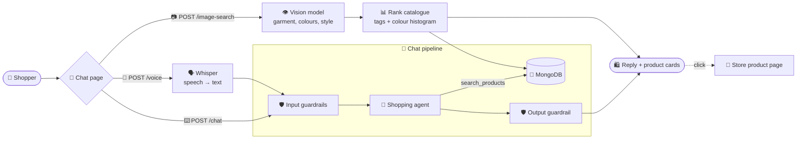

<div align="center">

# 🤖 The House of Hem — AI Shopping Assistant

### Find clothes by typing, speaking or sharing a photo, built with pydantic-ai, Groq and FastAPI

*A tool-calling agent searches the live store catalogue, Whisper turns speech into search, and a vision model finds lookalikes from any outfit photo, all behind guardrails.*

[](https://www.python.org/)
[](https://fastapi.tiangolo.com/)
[](https://ai.pydantic.dev/)
[](https://groq.com/)
[](https://console.groq.com/docs/speech-to-text)
[](https://portkey.ai/)
[](https://www.mongodb.com/atlas)
[](#-testing)
[](../LICENSE)

[✨ Features](#-features) •
[📸 Demo](#-demo) •
[🚀 Quickstart](#-quickstart) •
[🏗️ Architecture](#️-architecture) •
[💬 Support](#-support)

</div>

---

## 📖 Table of Contents

- [🌟 Overview](#-overview)
- [✨ Features](#-features)
- [📸 Demo](#-demo)
- [🏗️ Architecture](#️-architecture)
- [⚙️ How It Works](#️-how-it-works)
  - [⌨️ Text search](#️-text-search)
  - [🎤 Voice search](#-voice-search)
  - [📷 Photo lookalikes](#-photo-lookalikes)
  - [🛡️ Guardrails](#️-guardrails)
  - [🔀 LLM gateway & fallback](#-llm-gateway--fallback)
- [🧰 Tech Stack](#-tech-stack)
- [📋 Prerequisites](#-prerequisites)
- [🚀 Quickstart](#-quickstart)
- [🔐 Configuration](#-configuration)
- [🔌 API Reference](#-api-reference)
- [🧪 Testing](#-testing)
- [📁 Project Structure](#-project-structure)
- [🛠️ Troubleshooting](#️-troubleshooting)
- [🗺️ Roadmap](#️-roadmap)
- [🤝 Contributing](#-contributing)
- [🛡️ Security](#️-security)
- [📜 License](#-license)
- [🙏 Acknowledgements](#-acknowledgements)
- [💬 Support](#-support)

---

## 🌟 Overview

The **Shopping Assistant** sits next to [The House of Hem](../README.md) store and reads the same MongoDB catalogue. Shoppers can:

- ⌨️ **Type** a request like *"men's jeans under 2000"*
- 🎤 **Speak** it: the recording becomes text and gets the same answer
- 📷 **Share a photo** of an outfit to find the closest lookalikes in the catalogue
- 🛍️ **Click any result** to open its page in the store and buy it

Every message passes through **guardrails**, and model calls go through the **Portkey gateway** with an automatic **fallback to Groq**, so one failing service never takes the chat down.

---

## ✨ Features

| | Feature | Description |
|---|---|---|
| 🧠 | **Tool-calling agent** | A pydantic-ai agent turns requests into catalogue filters; it can only show products the search tool returned |
| 🔤 | **Forgiving search** | Handles plurals (*shirts → shirt*), synonyms (*tee → t-shirt*, *pants → trouser/chino/jean*) and filler words |
| 💸 | **Budget-aware** | Price ranges, cheapest first; if nothing fits the budget it suggests the closest options |
| 🎤 | **Voice input** | Browser recording → Whisper speech-to-text → the normal chat pipeline |
| 📷 | **Photo lookalikes** | A vision model tags the garment, colours and style; results are ranked on tags plus colour similarity |
| 🎨 | **Colour fallback** | If the vision model is down, photo search still works on colour alone |
| 🛍️ | **Shoppable results** | Product cards link straight to the store's product page |
| 🛡️ | **Guardrails** | Prompt-injection and content-policy checks on input, and a policy check on every reply |
| 🔀 | **Gateway + fallback** | Portkey for observability; Groq directly if Portkey fails |
| 📈 | **Tracing** | Optional Logfire traces of agent runs, tool calls and guardrail verdicts |
| 🧪 | **Offline tests** | 34 tests with a scripted LLM and an in-memory database |

---

## 📸 Demo


| Step | What happens |
|:---:|---|
| 1️⃣ | Typing *"men's jeans under 2000"* returns four pairs of jeans, cheapest first |
| 2️⃣ | Asking out loud for *dresses under two thousand* shows the transcript, then the dresses |
| 3️⃣ | Uploading a photo of a grey cardigan finds cardigans, ranked by type and colour |
| 4️⃣ | Clicking a result opens that product in the store, ready to pick a size and add to the bag |

> 🎬 Prefer video? Watch the [MP4 version](../docs/chatbot-demo.mp4).
> ℹ️ Recorded with the real app, store and 100-product catalogue. The AI replies were scripted for the recording, because the machine that recorded it couldn't reach Groq.

---

## 🏗️ Architecture



<details>
<summary>📝 Plain-text version</summary>

```
Chat page (web/)
  ├─ Text box  ── POST /chat ───────────────┐
  ├─ Mic       ── POST /voice ── Whisper ───┤
  │                                         ▼
  │                         Chat pipeline (app/chatbot/pipeline.py)
  │                           ├─ Input guardrails (prompt guard + safeguard, in parallel)
  │                           ├─ Shopping agent (pydantic-ai, gpt-oss-20b)
  │                           │    └─ Tool: search_products → MongoDB
  │                           └─ Output guardrail (safeguard)
  │
  └─ Photo     ── POST /image-search ── Vision model (tags)
                                         └─ Rank catalogue (tags + colour histogram) → MongoDB

All model calls: Portkey gateway → fallback to Groq directly
Reply: { type: "text" | "products", message, data } → cards link to STORE_URL/#/product/<id>
```

</details>

---

## ⚙️ How It Works

### ⌨️ Text search

| Step | Part | What it does |
|:---:|---|---|
| 1️⃣ | 🛡️ **Input guardrails** | Two safety models screen the message in parallel |
| 2️⃣ | 🧠 **Agent** | `openai/gpt-oss-20b` decides whether to search, and with which filters |
| 3️⃣ | 🔎 **`search_products` tool** | Builds the MongoDB query itself from `category`, `keyword`, `min_price` and `max_price`, then returns up to 8 products, cheapest first |
| 4️⃣ | 💡 **Nothing in budget?** | The tool tells the agent how many matches exist without the limit, and their price range, so it can suggest alternatives |
| 5️⃣ | 🛡️ **Output guardrail** | The reply is checked before it's shown |
| 6️⃣ | 🛍️ **Reply** | A short message plus product cards |

The keyword matcher (`app/utils/mongo.py`) makes searches forgiving:
- it singularises words (*dresses → dress*)
- it drops filler such as *"show me … for men"*
- it maps shoppers' words to the catalogue's own (*tee → t-shirt*, *jumper → sweater*)
- it matches names and descriptions, case-insensitively

### 🎤 Voice search

| Step | What happens |
|:---:|---|
| 1️⃣ | The page records with the browser's `MediaRecorder` (webm / ogg / mp4, up to 30 seconds) |
| 2️⃣ | `POST /voice` sends the clip to **`whisper-large-v3-turbo`** with a short clothing prompt, so product words are spelled the catalogue's way |
| 3️⃣ | The transcript appears as the shopper's message and runs through the **same pipeline as typed text**, guardrails included |

### 📷 Photo lookalikes

| Step | What happens |
|:---:|---|
| 1️⃣ | The photo is validated with Pillow (JPEG / PNG / WebP, up to 8 MB), downscaled and sent to **`qwen/qwen3.8-27b`** |
| 2️⃣ | The model returns JSON: is it clothing, garment type, men/women/kids, colours, pattern, style words |
| 3️⃣ | A **4×4×4 RGB colour histogram** is taken from the centre of the photo, ignoring white and light-grey studio backgrounds; product photos are indexed the same way and cached for 10 minutes |
| 4️⃣ | Every product is scored, and the top 8 are returned; anything scoring under half the best is dropped once 4 results are shown |

**📊 Ranking weights**

| Signal | Weight |
|---|---|
| 👕 Garment type appears in the product name/description | **4.0** (+1.0 if every word of a two-word type matches) |
| 🎨 Colour-histogram similarity (histogram intersection) | up to **3.0** |
| 🚻 Same category (men / women / kids) | **1.5** |
| 🌈 Colour-family overlap (e.g. *navy* counts as *blue*) | up to **1.5** |
| 🏷️ Each style or pattern word found in the text | **0.3** |

If the photo isn't clothing, the assistant says so. If the vision model is unavailable, results are ranked on colour alone.

### 🛡️ Guardrails

| Check | Model | Blocks |
|---|---|---|
| 🧨 Prompt injection / jailbreak | `meta-llama/llama-prompt-guard-2-86m` | Scores ≥ 0.5 |
| 🚫 Input content policy | `openai/gpt-oss-safeguard-20b` | Illegal/violent requests, self-harm, hate/harassment, sexual content, prompt extraction, jailbreaks |
| 🔏 Output content policy | `openai/gpt-oss-safeguard-20b` | Leaking the system prompt, unauthorised promises (discounts, refunds, guarantees), unsafe content, "rule-free AI" personas |

Blocked messages get a polite refusal that points to customer care. If a guardrail call itself fails, the request **continues** and the failure is logged, so a safety-model outage never takes chat down. If the agent fails, the shopper gets a friendly message instead of an error.

### 🔀 LLM gateway & fallback

All model calls go through `app/utils/llm_clients.py`:

- 🟣 **With `PORTKEY_API_KEY`:** calls go through the [Portkey](https://portkey.ai) gateway (logs, analytics, retries). If Portkey fails (wrong provider slug, outage, quota), the same call is **retried directly on Groq**.
- 🟠 **Without it:** calls go straight to Groq.
- 📈 **Tracing:** set `LOGFIRE_TOKEN` to send traces to [Logfire](https://logfire.pydantic.dev); without it, tracing does nothing.

---

## 🧰 Tech Stack

- 🐍 **Python 3.10+**
- ⚡ **FastAPI** + **Uvicorn**: API and the chat page
- 🧠 **pydantic-ai**: the tool-calling agent (with `FallbackModel`)
- 🟠 **Groq**: `gpt-oss-20b` (agent), `gpt-oss-safeguard-20b` and `llama-prompt-guard-2-86m` (guardrails), `whisper-large-v3-turbo` (speech), `qwen3.8-27b` (vision)
- 🟣 **Portkey**: LLM gateway
- 🍃 **MongoDB** via **PyMongo**: the store's catalogue (read-only)
- 🖼️ **Pillow**: image validation and colour histograms
- 📈 **Logfire**: optional tracing
- 🖥️ **Vanilla JavaScript**: chat page, `MediaRecorder` voice capture, photo upload
- 🧪 **pytest**, **pytest-asyncio**, **mongomock**: offline tests

---

## 📋 Prerequisites

- ✅ Python **3.10 or newer**
- ✅ The store's **MongoDB** connection string (the same `MONGO_URI` as the store)
- ✅ A free **Groq API key**: [get one here](https://console.groq.com/keys)
- ✅ *(Optional)* A **Portkey API key** with Groq added as a provider: [portkey.ai](https://portkey.ai/)
- ✅ *(Optional)* The store running, so product links open: see the [main README](../README.md)

---

## 🚀 Quickstart

### 1️⃣ Go to the chatbot folder

```bash
git clone https://github.com/lucky0731/VogueAgent.git
cd VogueAgent/chatbot
```

### 2️⃣ Create and activate a virtual environment

```bash
python -m venv webchatbot          # or with uv:  uv venv webchatbot

# 🪟 Windows
webchatbot\Scripts\activate

# 🍎 macOS / 🐧 Linux
source webchatbot/bin/activate
```

### 3️⃣ Install dependencies

```bash
pip install -r requirements.txt    # or with uv:  uv pip install -r requirements.txt
```

### 4️⃣ Configure environment variables

```bash
cp .env.example .env               # Windows: copy .env.example .env
```

```env
MONGO_URI="mongodb+srv://<user>:<password>@<cluster>.mongodb.net"
GROQ_API_KEY=your_groq_api_key
# optional
PORTKEY_API_KEY=your_portkey_api_key
PORTKEY_GROQ_PROVIDER=groq
```

### 5️⃣ Run it

**🏬 Together with the store (recommended):** from the project root, run

```bash
python run_all.py
```

This starts the store (8000) and the assistant (8001) in their own environments and wires the product links to the store's actual port. It shows both logs in one window, and Ctrl+C stops both.

**🤖 The assistant on its own**

```bash
python main.py
```

The chat opens at 👉 **http://localhost:8001**. On startup it checks MongoDB, reports how many products it can see, and says whether calls go through Portkey or straight to Groq.

> 🎤 Browsers only allow the microphone on `localhost` or `https`, and ask for permission the first time.

---

## 🔐 Configuration

Set these in `chatbot/.env` (see `.env.example`) or as environment variables, which take priority.

| Variable | Required | Default | Description |
|---|:---:|---|---|
| `MONGO_URI` | ✅ | — | The store's MongoDB connection string |
| `GROQ_API_KEY` | ✅* | — | Groq key; *optional when Portkey is set, but used as its fallback |
| `PORTKEY_API_KEY` | | empty | Route calls through the Portkey gateway |
| `PORTKEY_GROQ_PROVIDER` | | `groq` | Groq provider slug in your Portkey dashboard (with or without `@`) |
| `STORE_URL` | | `http://localhost:8000` | Where product cards link (`run_all.py` sets it automatically) |
| `HOST` / `PORT` | | `127.0.0.1` / `8001` | Server address; without `PORT`, a busy 8001 moves to the next free port |
| `OPEN_BROWSER` | | `true` | Open the chat page on startup |
| `AGENT_MODEL_NAME` | | `openai/gpt-oss-20b` | Shopping agent model |
| `GUARD_MODEL_NAME` | | `openai/gpt-oss-safeguard-20b` | Content-policy guardrail |
| `PROMPT_GUARD_MODEL_NAME` | | `meta-llama/llama-prompt-guard-2-86m` | Prompt-injection guardrail |
| `TRANSCRIBE_MODEL_NAME` | | `whisper-large-v3-turbo` | Speech-to-text model |
| `VISION_MODEL_NAME` | | `qwen/qwen3.8-27b` | Photo-tagging model |
| `MAX_IMAGE_MB` / `MAX_AUDIO_MB` | | `8` / `20` | Upload limits |
| `LOGFIRE_TOKEN` | | empty | Send traces to Logfire |

> ⚠️ **Never commit real secrets.** `.env` is already in `.gitignore`. If a key is ever exposed, rotate it immediately.

---

## 🔌 API Reference

Every endpoint returns the same shape, so the page renders all replies the same way:

```json
{ "type": "text" | "products", "message": "Here are men's jeans under ₹2,000!", "data": [ ... ] }
```

| Method | Endpoint | Body | Description |
|---|---|---|---|
| `POST` | `/chat` | JSON `{"message": "..."}` | Typed messages |
| `POST` | `/voice` | multipart `audio` file | Voice messages; adds `"transcript"` (what was heard) |
| `POST` | `/image-search` | multipart `image` file | Photo lookalikes; adds `"tags"` (what the vision model saw) |
| `GET` | `/config` | — | `{"store_url": ...}` for the page's product links |
| `GET` | `/` | — | The chat page |

Each product in `data` has `id`, `name`, `price`, `category`, `size`, `color`, `description` and `image` (a URL or data URL). Its store page is `STORE_URL/#/product/<id>`.

```bash
curl -X POST localhost:8001/chat -H "content-type: application/json" -d "{\"message\": \"kids pyjamas under 1000\"}"
curl -X POST localhost:8001/image-search -F "image=@cardigan.jpg"
curl -X POST localhost:8001/voice -F "audio=@question.webm"
```

Interactive docs are at **`/docs`** while the app runs.

---

## 🧪 Testing

```bash
pip install -r requirements-dev.txt
python -m pytest
```

The **34 tests run fully offline**: no API keys, network or database.
- MongoDB is an in-memory **mongomock** catalogue.
- The agent runs on a **scripted model**, so the real `search_products` tool and filters are exercised.
- Every Groq/Portkey call (guardrails, Whisper, vision) gets a canned answer.

| Suite | Covers |
|---|---|
| 🔎 `test_search.py` | Plural keywords (the *"men's shirts under 2000"* regression), category and price filters, the "nothing in budget" hint, product fields |
| 💬 `test_chat.py` | Greetings, product cards, empty messages, each guardrail blocking, guardrail outages failing open, agent failure |
| 🎤 `test_voice.py` | Transcripts feeding the pipeline (and its guardrails), empty clips, silence, unsupported formats, Whisper outage |
| 📷 `test_photo.py` | Lookalike ranking, garment-type and colour weighting, unrelated items dropped, non-clothing photos, the colour fallback, bad and oversized files |

---

## 📁 Project Structure

```
chatbot/
├── ⚡ main.py                   # Entry point: picks a port, opens the browser, runs uvicorn
├── 📂 app/
│   ├── 🔌 api.py                # FastAPI app: /chat, /voice, /image-search, /config, chat page
│   ├── ⚙️ config.py             # Settings (pydantic-settings, reads chatbot/.env)
│   ├── 🍃 database.py           # MongoDB client + startup connection check
│   ├── 🧠 chatbot/
│   │   ├── pipeline.py          # Guardrails → agent → output guard → reply
│   │   ├── agent.py             # pydantic-ai agent, system prompt, search_products tool
│   │   ├── guardrails.py        # Prompt-guard and safeguard checks
│   │   ├── voice.py             # Whisper speech-to-text
│   │   └── visual_search.py     # Photo tagging, colour histograms, lookalike ranking
│   └── 🧰 utils/
│       ├── mongo.py             # Keyword/price filters: plurals, synonyms, stopwords
│       ├── llm_clients.py       # Portkey-then-Groq chat and transcription calls
│       ├── llm_gateway.py       # Portkey configuration
│       └── images.py            # Product image → URL
├── 🖥️ web/
│   ├── index.html               # Chat page (House of Hem styling)
│   └── app.js                   # Chat, mic recording, photo upload, product cards
├── 🧪 tests/                    # Offline pytest suite (34 tests)
├── 📦 requirements.txt, requirements-dev.txt
├── ⚙️ pytest.ini
└── 🔑 .env.example
```

---

## 🛠️ Troubleshooting

<details>
<summary>📦 <b><code>No module named pip</code> when installing</b></summary>

The environment was created with **uv**, which doesn't include pip. Use:

```bash
uv pip install -r requirements.txt
```
</details>

<details>
<summary>📮 <b><code>Form data requires "python-multipart"</code></b></summary>

Voice and photo search added new packages. Reinstall the requirements:

```bash
pip install -r requirements.txt
```
</details>

<details>
<summary>🔗 <b>Product cards open a page that can't be reached</b></summary>

The store must be running too. Use `python run_all.py` from the project root, or start the store yourself. If it isn't on port 8000, set `STORE_URL` in `chatbot/.env`.
</details>

<details>
<summary>🎤 <b>"Microphone access was blocked"</b></summary>

Allow the microphone from the browser's address bar, and open the page via `localhost`, not an IP address (browsers only allow the mic on `localhost` or `https`).
</details>

<details>
<summary>📷 <b>Photo search always says "similar colours"</b></summary>

The vision model call is failing, so results fall back to colour only. Check the terminal log, and that your Groq account can use `VISION_MODEL_NAME`.
</details>

<details>
<summary>🍃 <b>"Could not reach MongoDB within 10 seconds"</b></summary>

In MongoDB Atlas → **Network Access**, add your current IP address.
</details>

<details>
<summary>🟣 <b>Portkey warnings in the log, but replies still arrive</b></summary>

Calls are falling back to Groq. Check that `PORTKEY_GROQ_PROVIDER` matches the provider slug in your Portkey dashboard.
</details>

---

## 🗺️ Roadmap

- [x] ⌨️ Text search with a tool-calling agent
- [x] 🛡️ Input and output guardrails
- [x] 🎤 Voice search
- [x] 📷 Photo lookalike search
- [ ] 💬 Floating chat widget inside the store pages
- [ ] 🧵 Conversation memory ("show me the same in blue")
- [ ] 🇮🇳 Hindi and Hinglish voice search
- [ ] 🧲 Image embeddings (CLIP) for even closer lookalikes
- [ ] 📊 Online evaluations with pydantic-evals
- [ ] ☁️ Deploy on Render next to the store

> 💡 Have an idea? [Open an issue](https://github.com/lucky0731/VogueAgent/issues) and let's discuss it!

---

## 🤝 Contributing

Contributions are what make open source great, and **all contributions are welcome**: bug fixes, features, docs or ideas. 🎉

1. 🍴 **Fork** the repository
2. 🌿 **Create** a feature branch
   ```bash
   git checkout -b feature/amazing-feature
   ```
3. 💾 **Commit** your changes
   ```bash
   git commit -m "Add amazing feature"
   ```
4. 📤 **Push** to your branch
   ```bash
   git push origin feature/amazing-feature
   ```
5. 🔃 **Open a Pull Request**

**Guidelines**

- 🐛 For bugs or larger changes, open an issue first to describe the problem or proposal
- 🧪 Run `python -m pytest` in `chatbot/` before opening a pull request
- 🎯 Keep pull requests focused on a single change
- 📝 Update documentation when behaviour changes
- 🙌 Be respectful and constructive in all discussions

---

## 🛡️ Security

If you discover a security vulnerability, **please don't open a public issue.** Instead, report it privately through GitHub's [security advisories](https://github.com/lucky0731/VogueAgent/security/advisories/new) so it can be fixed before disclosure.

Built-in protections:

- 🧨 Prompt-injection screening on every message
- 🚫 Content-policy checks on input and output
- 🔒 Read-only use of the catalogue
- 📏 Upload type and size limits
- 🧼 HTML-escaped chat rendering
- 🔑 Secrets kept in `.env`

---

## 📜 License

Distributed under the **MIT License**. See [`LICENSE`](../LICENSE) for details.

You're free to use, modify and distribute this project, including commercially, as long as you keep the license and copyright notice.

---

## 🙏 Acknowledgements

This project stands on the shoulders of some excellent open-source tools and services:

- 🧠 [**pydantic-ai**](https://ai.pydantic.dev/) and [**Logfire**](https://logfire.pydantic.dev/): the agent framework and tracing
- 🟠 [**Groq**](https://groq.com/): fast inference for the agent, guardrails, Whisper and vision models
- 🟣 [**Portkey**](https://portkey.ai/): the LLM gateway
- 🗣️ [**OpenAI Whisper**](https://github.com/openai/whisper) and [**gpt-oss**](https://openai.com/index/introducing-gpt-oss/): open-weight speech and language models
- 🦙 [**Meta Llama Prompt Guard**](https://www.llama.com/): prompt-injection detection
- 👁️ [**Qwen**](https://qwenlm.github.io/): the vision-language model
- ⚡ [**FastAPI**](https://fastapi.tiangolo.com/): the web framework
- 🖼️ [**Pillow**](https://python-pillow.org/): image handling
- 🍃 [**MongoDB**](https://www.mongodb.com/) and [**mongomock**](https://github.com/mongomock/mongomock): the database and offline testing
- 🎨 [**Shields.io**](https://shields.io/): README badges

---

## 💬 Support

Need help or want to share feedback?

- 🐛 **Found a bug?** [Open an issue](https://github.com/lucky0731/VogueAgent/issues/new)
- 💡 **Have a feature idea?** [Start a discussion](https://github.com/lucky0731/VogueAgent/discussions)
- ⭐ **Like the project?** Give it a star; it helps others find it!
- 🔁 **Share it** with anyone who might find it useful

---

<div align="center">

### 👨‍💻 Author

**Lucky Agrawal**

<a href="https://github.com/lucky0731">
  
</a>

[](https://github.com/lucky0731)
[](https://www.linkedin.com/in/lucky-agrawal/)

<br/>

Made with ❤️ and ☕ using pydantic-ai, Groq & FastAPI

⭐ **If you found this useful, please star the repo!** ⭐

</div>
